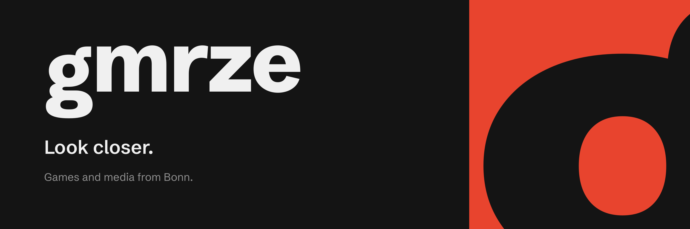

<picture>
  <source media="(prefers-color-scheme: dark)" srcset="https://raw.githubusercontent.com/gmrze/.github/main/gmrze-github-banner-dark.png">
  <source media="(prefers-color-scheme: light)" srcset="https://raw.githubusercontent.com/gmrze/.github/main/gmrze-github-banner-light.png">
  
</picture>

## About

gmrze makes games and media for players. The name is short for gamorize: turning something into a game. Strip the vowels from gamorize and you get gmrze.

We work from Bonn, Germany. This is where the code and files behind our work live.

## What we make

**Games.** Games for players, built with care for detail.

**Media.** Videos and other media that go with them, and some that stand on their own.

## Find us

- Website: [gmrze.net](https://gmrze.net)
- Brand guidelines: [gmrze.net/brand](https://gmrze.net/brand)

## Repositories

The pinned repositories above are the best place to start. Each one has its own README with build steps and current status.

## Feedback and contributions

Found a bug or have an idea? Open an issue in the repository it belongs to. Describe what you saw, what you expected and how to reproduce it. If you want to send a pull request for something bigger than a small fix, open an issue first so we can agree on the direction before you spend time on it.

## Using the gmrze name and logo

The name, the symbol and the wordmark belong to gmrze. Please don't use them in a way that suggests your project is made or endorsed by us. The [brand guidelines](https://gmrze.net/brand) describe how they are used.
